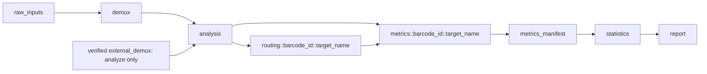

# M7 local workflow contract

M7 (`0.7.0`, schema 1 / `m7-v1`) orchestrates existing M2, M3.1.2, M4,
M5 and M6.1 Python APIs. It does not classify reads, calculate metrics or
statistics, or render figures itself. Execution is local and serial.

**Production execution supports one biological target per workflow, with one or
more copies/homeologs.** M4 requires an already target-specific eligible read
population. There is no qualified cross-target read selection contract. At the
user's explicit direction, more than one `target_name` fails before creating the
workspace with `MULTI_TARGET_EXECUTION_UNSUPPORTED`. Multi-target DAG planning
and mocked orchestration tests are supported; this is not production multi-target
qualification. Input FASTQs must belong to the requested biological target.

## Commands and Python APIs

```sh
peanalyzer run --r1 raw_R1.fastq.gz --r2 raw_R2.fastq.gz \
  --samples samples.csv --targets targets.csv --config config.yaml \
  --output results --crispresso /path/to/CRISPResso \
  --runtime-digest pinellolab/crispresso2@sha256:b7e7971a87769aa584d31d21e199a9abca5f641c4f889c2e807cb6324fc8ce0c \
  --analysis-r1-trim-5p 8 --analysis-r2-trim-5p 8 \
  --contrasts contrasts.yaml --title 'Synthetic experiment'

peanalyzer analyze --demux-root existing-demux \
  --samples samples.csv --targets targets.csv --config config.yaml \
  --output analyzed --crispresso /path/to/CRISPResso \
  --runtime-digest EXPLICIT_RUNTIME_IDENTITY \
  --analysis-r1-trim-5p 8 --analysis-r2-trim-5p 8
```

The example trim sizes are for the synthetic 8+8 barcode fixture, not biological
recommendations. Use the existing preparation contract for the actual library.
Both commands accept `--barcodes`, `--tolerance-policies` (existing M4 request
list in YAML/JSON), `--contrasts`, `--title`, `--resume`, and repeatable `--force`.
Without contrasts, M5 `summarize()` executes; with an explicit specification,
M5 `stats()` executes. M7 never invents contrasts or biological metadata.
The backend executable is explicit and must resolve to CRISPResso2 2.3.4.
Runtime identity must be supplied; unqualified runtime digests retain M4's
existing reportability gates. An executable is not assumed to come from Docker.

`peanalyzer.workflow` exposes `build_workflow_plan`, `execute_workflow`,
`resume_workflow`, and read-only `verify_workflow_output`. The CLI is a thin
wrapper, returns a concise JSON execution/reuse summary on success, and exits 2
with the failing stage/reason on operational failure. The verifier never executes
CRISPResso, routing, metrics, statistics or rendering.

## DAG and workspace



Run uses the raw/demux branch; analyze uses the external branch. Samples and
biological targets are sorted, and all copy rows sharing a target remain together.
`barcode_id` is the M4 sample identity, never the display `sample_name`. The plan
contains exactly one routing and metrics node per sample × target, with validated
unique nodes/dependencies and a fixed acyclic topology. Reordering CSV rows keeps
DAG semantics stable, although exact input-byte hashes change.

```text
results/
  workflow_manifest.json           completion marker, published last
  workflow/plan.json               current strict DAG and input identity
  workflow/plans/<sha256>.json     retained plan history
  workflow/stages/<id-digest>.json validated completed-stage records
  workflow/failures/               diagnostics, never completion
  workflow/sessions/               argv/cwd, UTC timing, execution/reuse history
  workflow/sources/                owned source identity records
  inputs/<content-sha256>/         exact small-input snapshots, retained history
  demux/                          run only: immutable M2 archive
  analysis/                       verified separate prepared FASTQs
  routing/<barcode_id>/<target>/
  metrics/<barcode_id>/<target>/result.json
  metrics/manifest.csv             result_json column, relative sorted paths
  statistics/                     exact M5 result and TSVs
  report/                         exact M6.1 result copy, HTML, SVGs, tables
```

A workspace may exist while incomplete. Directory presence never means success.
Only a verified `workflow_manifest.json` marks completion. Raw FASTQs are streamed
through SHA-256 and recorded with resolved paths and byte sizes, never copied into
the workspace. Small metadata/configuration/catalog/contrast/policy inputs have
exact-byte content-addressed snapshots. Analyze verifies, hashes and inventories
its external demux archive without copying or modifying it.

## Identity, validation and resume

Stage signatures hash canonical JSON: workflow contract, stable node/sample/target
identity, pipeline version, Git commit/dirty state where available, Python and
dependency versions, package code/resource hashes, relevant normalized parameters,
input byte hashes/sizes, and dependency signature/output identities. Metrics also
include resolved executable identity/hash/version and explicit runtime digest.
Timestamps, session IDs and temporary paths do not enter signatures. Absolute
Python executable paths do not define science. Root-bound existing child
provenance still makes relocation unsupported.

A stage manifest is published atomically only after its API returns, its outputs
validate and their actual bytes are hashed. It records signature, dependencies
(including completed manifest hashes), outputs, parameters, software/backend
identity, API name, UTC timing and validation outcomes. Status is `COMPLETED` or
routing-only `SKIPPED_SCIENTIFIC_GATE`, not a biological result status. Failed
stages have diagnostic records and no completion record.

Reuse requires the expected signature, exact dependency records, unchanged output
inventory/hashes, and the original stage validator. Demux, analysis and routing
use their existing verifiers with source lineage, sample, target and policy
checks. M4 strict-loads `MetricResult`, verifies sample/target identity and all
recorded artifacts, without recomputing PE metrics. The deterministic M5 CSV
must cover exactly the expected sample × target population; missing, duplicate,
unexpected or swapped results fail. M5 strict-loads `StatisticsResult` and verifies
its manifest, metadata, contrast and M4 source hashes. M6 strict-loads its manifest,
checks every inventoried artifact, exact M5 source copy, SVG XML and inline content.

Immediately before final publication, every required completion is revalidated.
The final strict manifest hashes the plan and all stage manifests, records inputs,
software, the execution session, final M5/report identities and limitations.
There is no self-hash: stage manifests hash stage files; the workflow manifest
hashes stage manifests. Packaged JSON schemas forbid unknown fields where intended;
Pydantic additionally enforces graph and cross-field invariants. JSON publication
uses a temporary sibling, fsync and atomic replace.

An already-completed valid `--resume` executes zero stage APIs, validates all
stages, records the session, and preserves the completed manifest bytes. A changed
signature or corrupted output fails without suitable force. Directory presence
without an M7 completion record is `ORPHANED_STAGE_OUTPUT`; force is required.
If a failure occurred before creating any stage output, resume can execute that
stage naturally after validating upstream completions. A failure before the first
validated plan is published requires a new workspace; M7 does not guess ownership
of an unplanned directory.

## Selective force and protection

Force requires resume. Multiple options take the union of descendant closures.

| Family | Invalidated stages |
|---|---|
| report | report |
| statistics | statistics, report |
| metrics | all metrics nodes, metrics manifest, statistics, report |
| routing | all routing nodes and metrics descendants |
| analysis | analysis and all descendants |
| demux | run-mode source record, demux and all descendants |
| all | all owned nodes; never external inputs |

Analyze rejects `--force demux`; changing its external archive requires a new
workspace. Raw or sample/config/catalog changes conservatively require demux force
(run) or analysis force (analyze metadata). Trims require analysis; target changes
require routing; tolerance requests/runtime require metrics; contrasts require
statistics; title requires report. Inventory changes without sufficient force are
`WORKFLOW_GRAPH_MISMATCH`. Growth/shrink removes obsolete owned completions and
results before rebuilding the current coverage inventory. Downstream-only force
cannot legalize an invalid upstream result.

Force removes the final completion marker **before** deleting any stage output.
Deletion is limited to fixed graph-owned paths validated against the plan, with
containment and ancestor/nested symlink rejection. Raw inputs, metadata and external
archives are never force-deleted. Output roots, stage paths, completion paths and
stored artifact paths reject traversal, absolute children and symlink ambiguity.

An exclusive sibling `.<output-name>.m7-lock` covers the entire invocation. Owned
locks are removed on normal unwinding, including SIGTERM via the CLI's existing
cleanup context; foreign locks are preserved. A hard kill can leave a stale lock:
inspect process ownership before removing it manually. Concurrent malicious
filesystem replacement is not an authenticated-storage threat model; local hashes
protect against corruption, not coordinated rewriting of all provenance.

## Scientific and operational boundaries

Existing geometry decides whether copy routing is available. A blocked geometry
creates an explicit routing gate record, calls M4 with no usable routing root,
and lets M4 retain blocked copy metrics while evaluating supported target metrics.
Every participating sample still has an M4 result. Backend execution failures,
corrupt files, invalid lineage and M6.1 `INVALID_GENERATED_SVG` stop construction;
none become biological zeros. A partial M4 output directory remains an orphan
until explicitly forced. No M4 change was needed for this behavior.

M4 populations/denominators, M5 biological inferential units and stored statistics,
and M6 presentation remain authoritative. No Pooled production routing, generalized
models, automated interpretation, distributed execution, scheduler integration,
automatic parallelism or portable CRISPResso HTML links are added.

See [qualification and reproducible evidence](validation/m7/README.md) for the
real synthetic fixture, source/wheel results and exact parity exclusions.
